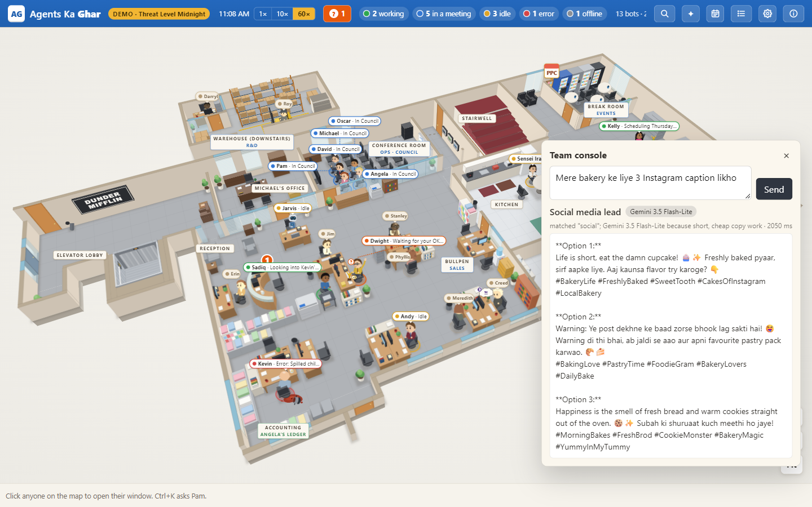
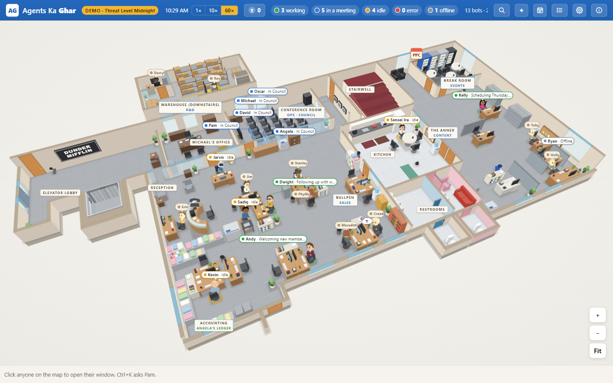
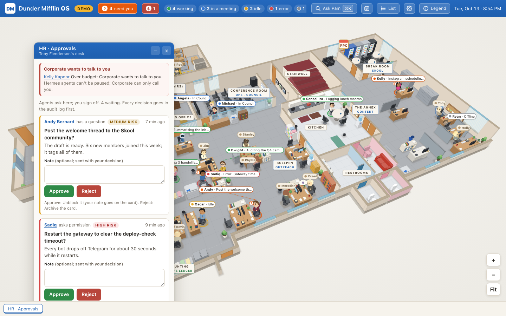

# Digital Marketing AI Agent Team

A local, browser-based **AI agent team for digital marketing and vibe-coding** — an office-style dashboard where every
agent has a desk, a status and a job. Type one command, and the app picks the right specialist and the right AI model,
then does the work.

Free to run. No paid API. No cloud account. Everything stays on your machine.



---

## What this actually is

Most "AI agent" demos are a chat box. This one is a **workplace**:

- **23 desks** on an isometric office floor. Each agent has a live status — working, in a meeting, idle, error, offline.
- **A team console.** Type a task in plain Hindi, Hinglish or English. The server classifies it, routes it to the
  matching specialist, and picks the model tier that task deserves.
- **A visible routing decision.** Every answer shows *who* handled it and *why* that model was chosen, so nothing is a
  black box.
- **Approvals.** When an agent needs your sign-off, it raises a hand. Approve or reject from the HR desk, and the
  decision is written to an audit log before anything else happens.
- **Two data sources.** A scripted demo day for showing the product, and a live mode that reads a real agent runtime
  read-only.

---

## Why the routing matters

The whole point of a team is that you do not hand every job to the same person. The router is rule-based and
deterministic, so the same command always lands on the same specialist:

| You type | Specialist | Desk |
|---|---|---|
| "audit my landing page SEO" | SEO analyst | Neha |
| "Google Ads copy for a Diwali sale" | Paid ads manager | Meera |
| "cold email sequence for SaaS founders" | Email marketer | Aisha |
| "3 Instagram captions for my bakery" | Social media lead | Priya |
| "why did conversions drop in GA4" | Analytics lead | Fatima |
| "design a thumbnail for this reel" | Creative director | Tara |
| "fix the React bug on the pricing page" | Web developer | Sadiq |
| "write a blog post about AI agents" | Content writer | Aanya |
| anything else | Marketing lead | Zara |

Model tier is picked automatically too:

| Tier | When | Model |
|---|---|---|
| **fast** | short copy, captions, one-liners | Gemini 3.5 Flash-Lite |
| **balanced** | normal strategy and writing | Gemini 3.5 Flash |
| **deep** | audits, plans, long multi-step asks | Gemini 3.5 Flash (long) |

Free tier only. If the minute limit is hit, the app says so plainly instead of silently failing.

---

## Quick start

Requires **Node.js 20+**.

```bash
git clone https://github.com/Rachit-Sharma08/digital-marketing-ai-agent-team.git
cd digital-marketing-ai-agent-team
npm install
npm run build
```

Set one free API key (Google AI Studio → free tier):

```bash
# Windows PowerShell
$env:GEMINI_API_KEY = "your-key"

# macOS / Linux
export GEMINI_API_KEY="your-key"
```

Run it:

```bash
node bin/agents-ka-ghar.mjs --demo
```

Open <http://127.0.0.1:4318>, click **✦ Team**, type a command.

Without a key the office still runs — only the console reports that no model is available.

### Live mode

Live mode reads a real agent runtime **read-only**:

```bash
node bin/agents-ka-ghar.mjs --port 4319
```

It reads status files, kanban cards, sessions and cron jobs from `~/.hermes` (or `%USERPROFILE%\.hermes`). It never
touches `.env`, tokens or credentials. If a source is missing, that panel degrades to empty instead of crashing.

---

## How it works

```
browser (React)
    │  GET /api/office        -> snapshot: people, presence, tasks, rooms
    │  GET /api/events        -> SSE, live updates
    │  POST /api/agents/command
    ▼
local server (Node, 127.0.0.1 only)
    │
    ├── router            text -> specialist + model tier
    ├── adapter: demo     scripted fictional day, in memory
    ├── adapter: live     read-only reader over ~/.hermes
    └── model call        Gemini free tier, key from the environment
```

- The server binds to loopback only. Nothing is published to the internet by default.
- Every write endpoint (chat, tasks, approvals, commands) is refused unless writes are explicitly enabled.
- Requests are rate-limited, bodies are size-capped and validated at the boundary.
- The model key is read from the environment and never written to a file or a log.

### API

```http
GET  /api/agents            # who is on the team, and whether a key is configured
POST /api/agents/command    # { "text": "..." } -> agent, model, answer
```

Example response:

```json
{
  "agent": { "kind": "social", "person": "priya", "title": "Social media lead", "reason": "matched \"social\"; Gemini 3.5 Flash-Lite because short, cheap copy work" },
  "model": { "tier": "fast", "id": "gemini-3.5-flash-lite", "label": "Gemini 3.5 Flash-Lite" },
  "answer": "...",
  "tookMs": 1372
}
```

---

## Screenshots

| Office floor | Team console | Approvals |
|---|---|---|
|  |  |  |

More in [`docs/screenshots`](docs/screenshots).

---

## What is real and what is a demo

Being precise about this matters more than a feature list:

| Works today | Not built yet |
|---|---|
| Command routing to 9 specialists | Publishing to ad platforms |
| Real model calls on the free tier | Spending money on ads |
| Live office status from a real runtime | Autonomous multi-hour agent runs |
| Approvals with an audit trail | Auto-posting to social accounts |
| Demo day and live mode | Billing and team accounts |

Real ad-platform actions need OAuth per platform and a business account. That is out of scope for a free local app,
and this README does not pretend otherwise.

---

## Status

- Web test suite: 626 passing.
- Server test suite: 631 passing, 11 failures that are Windows path-separator assumptions in the upstream tests (not
  caused by this work).
- Typecheck clean across web and server.

---

## Attribution

This project is a fork of [agents-ka-ghar](https://github.com/stephenlthorn/agents-ka-ghar) by Stephen Thorn,
used under the MIT licence. The office map, desk layout and UI foundations come from that project. The agent routing
layer, the team console, the branding and the documentation here are new work.

The office theme is a fan-styled homage, not an official product. **the workspace** and **Agents Ka Ghar** are trademarks
of their respective owners. No affiliation or endorsement is implied. The theme is presentational only — it can be
replaced without touching the agent layer.

See [LICENSE](LICENSE).

---

## Author

**Rachit Sharma** — [@Rachit-Sharma08](https://github.com/Rachit-Sharma08)

Built as a working study in agent routing, local-first tooling and digital marketing automation.
